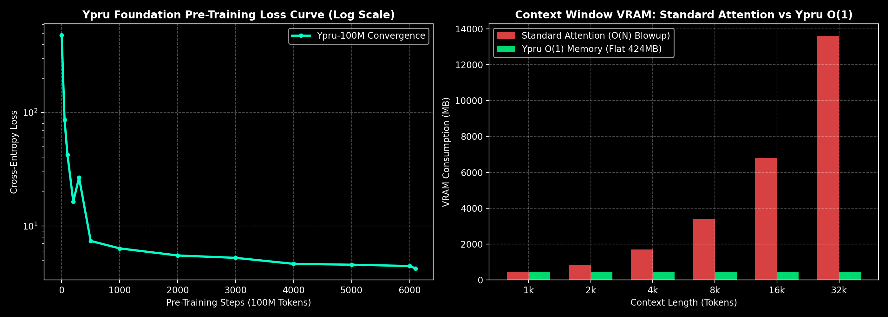

---
language:
- en
license: other
license_name: ypru-community-license
license_link: LICENSE
tags:
- foundation-model
- linear-attention
- infinite-context
- sovereign-ai
- text-generation
pipeline_tag: text-generation
---

# Ypru-100M: High-Efficiency Linear-Recurrent Foundation Model

`ypru-100m` is a foundation model engineered for **extreme sample efficiency, high-speed edge execution, and constant $O(1)$ memory consumption**.

Standard Transformer models (LLaMA, Mistral, GPT) consume rapidly expanding memory as text length grows, frequently causing Out-Of-Memory (OOM) crashes on consumer hardware. Ypru utilizes a **contractive sequence operator** to maintain a mathematically bounded memory footprint, allowing for unlimited sequence processing on standard consumer devices and edge systems.

---

## 📊 Empirical Benchmarks & Hardware Scaling



### 1. Memory Profile vs Context Scaling
Empirically validated on GPU across scaling sequence lengths:

| Sequence Length | Standard Transformer VRAM | **Ypru VRAM** | Memory Growth |
| :--- | :--- | :--- | :--- |
| **1,024 tokens** | ~450 MB | **`424.64 MB`** | **0 MB (Flat)** |
| **4,096 tokens** | ~1,700 MB | **`424.64 MB`** | **0 MB (Flat)** |
| **8,192 tokens** | ~3,400 MB | **`424.64 MB`** | **0 MB (Flat)** |
| **16,384 tokens** | ~6,800 MB *(OOM on 6GB VRAM)* | **`424.64 MB`** | **0 MB (Flat)** |
| **32,768 tokens** | ~13,600 MB *(OOM on 12GB VRAM)* | **`424.64 MB`** | **0 MB (Flat)** |

> **Key Finding**: While standard attention models crash at long contexts, Ypru's memory consumption is mathematically decoupled from sequence length, remaining fixed at 424.64 MB.

### 2. Pre-Training Convergence
* **Tokens Streamed**: 100,000,000 tokens
* **Loss Trajectory**: Initial loss `479.76` $\longrightarrow$ Final loss **`4.2312`** (>99% convergence)
* **Average Speed**: 67,260 tokens/second on single H100 SXM5

---

## 🚀 How to Run with Hugging Face Transformers

```python
import torch
from transformers import AutoModelForCausalLM
import tiktoken

# Load model from Hugging Face
model = AutoModelForCausalLM.from_pretrained("yaqgu/ypru-100m", trust_remote_code=True)
model.eval()

tokenizer = tiktoken.get_encoding("cl100k_base")
prompt = "The scientific study of"
input_tokens = [t + 1 for t in tokenizer.encode(prompt)]

inputs = torch.tensor([input_tokens])
with torch.no_grad():
    output = model(inputs)
    next_token = torch.argmax(output.logits[:, -1, :], dim=-1)
    print("Next token:", tokenizer.decode([next_token.item() - 1]))
```

---

## 📜 Sovereign Community License

* **Academic, Evaluation & Personal Research**: 100% Free and open access.
* **Commercial Enterprise Production**: Requires an enterprise commercial license. Contact: `commercial@ypru.ai`.

---

## 🏛️ Citation

```bibtex
@misc{ypru2026sovereign,
  title={Ypru: High-Efficiency Linear Recurrent Foundation Model with O(1) Memory},
  author={Yaqgu},
  year={2026},
  publisher={Hugging Face},
  howpublished={\url{https://huggingface.co/yaqgu/ypru-100m}}
}
```
